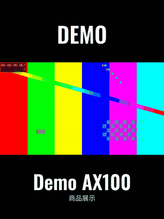

# 片刻 · Pianke Studio

本地运行的 Windows 商品视频工作台。把商品清单整理成待办，检索候选素材、核对型号、剪辑并导出商品视频。

**源码采用 MIT，核心流程不需要 API 密钥。** 可选云服务由使用者自行配置并承担费用；本项目不提供共享密钥或收费后端。



> 上图由本项目的离线演示生成器制作，仅展示成片版式。不是从他人视频搬运的商品素材，也不是完整操作录屏。

## 第一版能做什么

- 导入 XLSX / CSV / TSV、粘贴商品；预览列匹配、可见行、去重和配件跳过规则，再确认建待办。
- 商品级状态、制作历史、重做、失败记录和批量操作，每批最多 100 个任务，顺序处理。
- 按品牌、型号检索公开视频候选；不明确的型号停下来人工核对。支持多站点链接尝试，不保证“全网都能下载”。
- FFmpeg 输出 **1080×1440（3:4）** 商品视频，默认最长 90 秒；支持起止时间、标题、简短商品类别、字体排版和结尾 1 秒淡出。
- 文字、字幕位置、品牌素材、原片预览、成片保存路径与批量导出 ZIP。
- 可选：离线语音识别、中文翻译、智能连续 30 秒选片与封面、DeepSeek 视觉复核、SnapAny 下载备用通道。

**不是**通用桌面时间线剪辑器、多用户 SaaS、无限制下载器或版权审核系统。没有 100 条真实商业视频整批端到端成功的保证。

## 安装：Windows 10/11 x64

首次安装需要联网。先准备：

1. [64 位 Python](https://www.python.org/downloads/windows/) 3.11+，推荐 3.12；安装时启用 PATH。无需安装 Codex。
2. 如需 YouTube 检索/下载，建议安装 [Node.js](https://nodejs.org/) 22+ 并加入 PATH。
3. 下载源码 ZIP 并解压到自己有写入权限的目录，例如自己的视频工作目录。不要放进 Windows、Program Files 或网盘同步中的只读目录。

然后：

1. 双击 **SETUP.bat**：创建项目私有 `.venv`、安装 Pillow / yt-dlp、下载默认字体与 FFmpeg。
2. 安装完成后双击 **START_EDITOR.bat** 或 **启动工作台.bat**。
3. 浏览器访问 [本地工作台](http://127.0.0.1:8765/)。

FFmpeg 安装器优先使用 [BtbN Windows builds](https://github.com/BtbN/FFmpeg-Builds/releases)，网络失败时尝试固定的 [Gyan 备用源](https://www.gyan.dev/ffmpeg/builds/)，始终核对所选发布方的 SHA256；不会执行下载的安装脚本或跳过校验。也可自行把可信的 `ffmpeg.exe`、`ffprobe.exe` 放在 `tools/ffmpeg/bin/` 后重试安装。第三方许可见 [THIRD_PARTY_NOTICES.md](THIRD_PARTY_NOTICES.md)。

初次安装约需数百 MB 磁盘空间，工作素材另计；默认不下载数 GB 的语音/翻译/视觉模型。安装、测试和运行生成的文件留在项目目录；成片可在「保存路径」中另选本机目录。现有安装的设置与素材不会被安装器清空。

## 不找素材，先跑一次离线演示

安装完成后双击 **DEMO.bat**：

- 本机生成 6 秒测试图案和测试音，不调用网站、模型或付费 API。
- 用真实 FFmpeg 导出 1080×1440 成片，结果位于 `outputs/`。
- 不导入或修改你的真实待办，不覆盖已有原片或成片。
- 若想在界面里试操作，演示生成后导入 [examples/products.csv](examples/products.csv)，再按正常流程制作。

CSV 中 `example.com/pianke-demo.mp4` 是本机合成原片的演示标识，不是真实网络视频地址。必须先生成演示原片；不要把它当成下载测试链接。

## 正常使用

1. 导入自己的商品清单，核对预览。默认跳过 Excel 隐藏行；原表不会改写。
2. 勾选商品，开始制作。明确匹配才自动采用；错误型号、对比视频等需人工核对。
3. 「只抓素材链接」仅检索；开始制作才自动衔接下载、处理和导出。
4. 在商品详情核对原片和起止时间；生成新版不会覆盖旧成片。
5. 勾选完成商品，打包下载；下载列表与制作状态分别记录。

最小输入示例：`Demo AX100 | 商品展示 | 你有权使用的公开视频链接`。

输出示例：`品牌_型号_商品类别_时间戳.mp4`，配套 JSON 来源/参数记录；启用字幕时还可输出 SRT。品牌、型号或类别不明确时不会保证命名准确。

只下载自己拥有或已获得许可的素材。公开视频、搜索命中和提取成功均不代表允许商用。需要登录、DRM、私密或付费权限的内容可能无法处理；项目不会自动读取浏览器 Cookie 或擦除创作者水印。

## 可选增强：先用核心，再按需要安装

新安装在没有视觉环境时默认手动时段、不开智能封面；已有用户设置不改变。

| 功能 | 安装入口 / 条件 |
| --- | --- |
| 13 个字体家族与预设 | PowerShell 执行 `powershell -ExecutionPolicy Bypass -File scripts/setup.ps1 -AllFonts`；默认仅安装 Oswald＋思源黑体 |
| 离线语音字幕 | 双击「安装语音字幕.bat」，下载独立依赖和 Whisper base；安装后在制作设置勾选字幕 |
| 离线中文翻译 | 双击「安装中文翻译.bat」；需要额外本地模型和磁盘空间 |
| 智能选片 / 封面 | 执行 `powershell -ExecutionPolicy Bypass -File scripts/setup_studio.ps1`；推荐 Python 3.12 x64；安装后在界面主动选择智能模式 |
| SVG 品牌素材 | 执行 `powershell -ExecutionPolicy Bypass -File scripts/setup_brand_logos.ps1` |
| DeepSeek 复核 | [本机 API 设置](http://127.0.0.1:8765/api-settings)，自己填写密钥，默认关闭；上传与计费需确认 |
| SnapAny 备用下载 | [国内外素材设置](http://127.0.0.1:8765/sources#snapany)，自己填写独立密钥并选择本地失败后使用；默认关闭 |

云服务不是核心依赖。SnapAny 只解析已有视频链接，不负责商品检索；同一链接可短时复用解析结果。它不能保证下载全部候选视频，成功解析后即使下载失败也可能已扣积分。详见 [SnapAny 接入说明](SnapAny接入说明.md)。

字体说明随源码发布：[基础字体说明](assets/fonts/使用说明.md)、[高级字体包说明](assets/fonts/高级字体包说明.md)。字体文件、下载清单和本机对比图不随源码发布；生成对比图不会覆盖这两份说明。

## 开发与测试

PowerShell：

```powershell
# 安装完成后
.\.venv\Scripts\python.exe -B scripts\doctor.py
.\.venv\Scripts\python.exe -B -m unittest discover -s scripts -p "test_*.py" -v
.\.venv\Scripts\python.exe -B scripts\release_check.py
.\.venv\Scripts\python.exe -B scripts\release_check.py --package
```

也可双击 RUN_TEST.bat。基础测试不需要真实密钥；未安装的可选字体/模型、私有历史样本和显式网络/媒体测试会标注跳过，而不是伪装通过。实际安装、导出及测试范围见 [第一版验证记录](docs/RELEASE_VALIDATION.md)。首次源码发布的 GitHub Actions 工作流已提供，但只有推送后才能确认云端运行结果。

打包器采用公开文件白名单，生成 `dist/` 中的源码 ZIP 和包内 SHA256 清单，不打包工作目录全量内容。它的模式扫描不是安全保证；发布前仍应审查 Git 暂存区、历史和许可证。

## 目录与隐私

```text
scripts/       本地服务、安装器、渲染与测试
web/           无构建步骤的本地网页
configs/       默认模板；本机设置与任务配置不发布
examples/      脱敏演示输入
assets/fonts/  安装时下载的私有字体与许可
tools/ models/ 按需安装，不纳入源码
data/          本机队列、业务数据、加密密钥，不纳入源码
sources/       原片，不纳入源码
outputs/       成片，不纳入源码
work/ cache/   日志、测试与缓存，不纳入源码
```

原始商品表不随源码分发。密钥使用 Windows DPAPI，只能由保存它的 Windows 账号解密，迁移电脑/账号需重新填写。不要公开任何运行数据、截图中的私密信息或真实凭据。

## 常见问题

- **打开网页失败**：先用 START_EDITOR.bat 启动后台，再看 `work/editor_server/` 日志；关浏览器不等于停后台。
- **安装失败**：检查 Python、PyPI、字体源和 FFmpeg 源网络；可重试，不会清空业务数据。
- **YouTube/B站/抖音等抓不到**：可能是网络、风控、站点变化或权限问题；更新下载器、换公开链接或配置可选服务，不承诺万能。
- **字体或模型缺失**：先运行 doctor，安装需要的可选组件；默认安装不含所有字体和 AI 模型。
- **搬到其他目录/电脑**：重新安装依赖；不要复制加密密钥。若原保存路径不可用，需在本机 `configs/storage.json` 中移除旧目录设置（先备份）再启动。
- **多人公网使用**：不支持。只绑定 127.0.0.1，无账号/租户隔离，不要直接映射到公网。
- **系统兼容**：本版只验证 Windows；macOS、Linux 未承诺支持。

## 许可与参与

项目源码：[MIT](LICENSE)。外部组件、字体、模型、视频与商标各自保留原许可或权利，不由本项目重新授权。

欢迎提交脱敏问题与改进；参阅 [贡献指南](CONTRIBUTING.md)、[安全说明](SECURITY.md) 和 [变更记录](CHANGELOG.md)。
